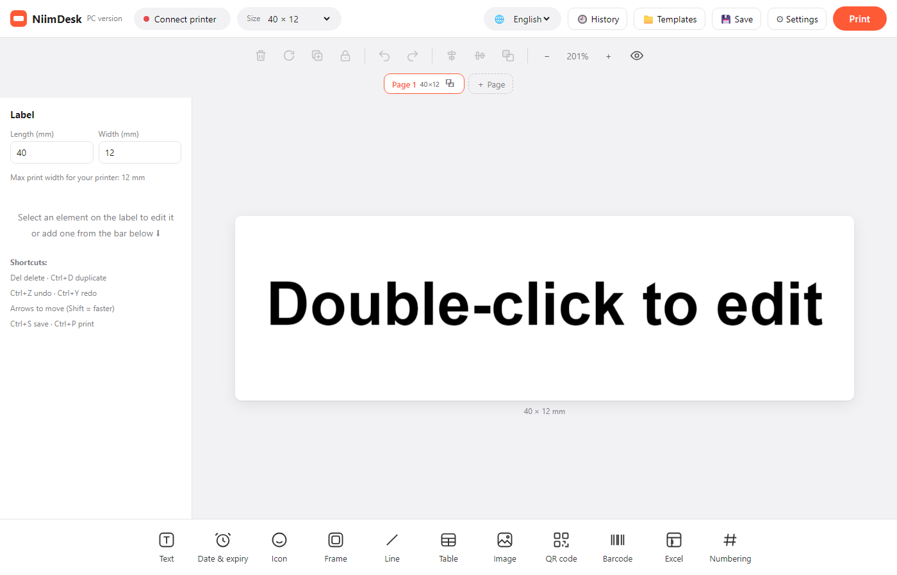

# NiimDesk — PC Version

A **free, open-source** label designer for **NIIMBOT** label printers on Windows, with full Arabic (RTL) and English support.

> ⚠️ NiimDesk is an independent project, **not affiliated with or endorsed by NIIMBOT**. "NIIMBOT" is a trademark of its respective owner.

## ⬇️ Download

1. Download **NiimDesk.exe** from [Releases](../../releases/latest).
2. Double-click it. No installation needed.
3. Connect the printer with a **USB cable**, then click **Connect printer → USB cable**.

> **Windows SmartScreen:** the file is not digitally signed, so Windows may show "Windows protected your PC". Click **More info**, then **Run anyway**. All the source code is here, so you can review it or build the EXE yourself.

**Requirements:** Windows 10 or 11, with **Microsoft Edge** or **Google Chrome** (the app opens in them as a standalone window).

## ✨ Features

- **Easy editor:** drag and drop, zoom, rotate, lock, undo/redo, and snapping.
- **Elements:** Arabic and English text, automatic production/expiry dates, icons, frames, lines, tables, images, QR codes, barcodes (CODE128, EAN13 and more), and serial numbering.
- **Multiple pages:** several labels in one file, printed together.
- **Batch printing from Excel/CSV:** link spreadsheet columns to the label and print one label per row.
- **Ready-made templates:** price, special offer, shelf life, names, folders, cables and more.
- **Print history:** reprint any previous label in one click.
- **Backup/restore:** all templates and settings in a single file.
- **Works offline.** All data stays on your computer.

## 🖨️ Printers

Tested on the **NIIMBOT D11_H** over USB. It should also work with the other printers supported by [niimbluelib](https://github.com/MultiMote/niimbluelib), such as the D11, D110, B1 and B21.

**About Bluetooth:** on the tested printer, Bluetooth printing from a PC produces blank labels (the same happens on niim.blue). **USB is the reliable option.**

## 🛠️ Build from source

- **Run from source:** `python serve.py` (Python 3) opens the app from the project files.
- **Build the EXE:** run `build-exe.bat`. It compiles `exe-src/Launcher.cs` with the C# compiler that ships with .NET Framework 4 (built into Windows) and embeds the web files. The output goes to `dist/NiimDesk.exe`.

The EXE is a small local web server. It listens on `localhost` only (ports 8765 to 8768), serves the embedded files, and exits about a minute after the app window is closed. It installs nothing and needs no admin rights.

## Credits

Printing uses [niimbluelib](https://github.com/MultiMote/niimbluelib) by MultiMote, the library behind [niim.blue](https://niim.blue) (MIT). NiimDesk also uses [JsBarcode](https://github.com/lindell/JsBarcode) (MIT), [qrcode-generator](https://github.com/kazuhikoarase/qrcode-generator) (MIT) and [SheetJS](https://sheetjs.com) (Apache-2.0). See [licenses.txt](licenses.txt).

## License

[MIT](LICENSE)
